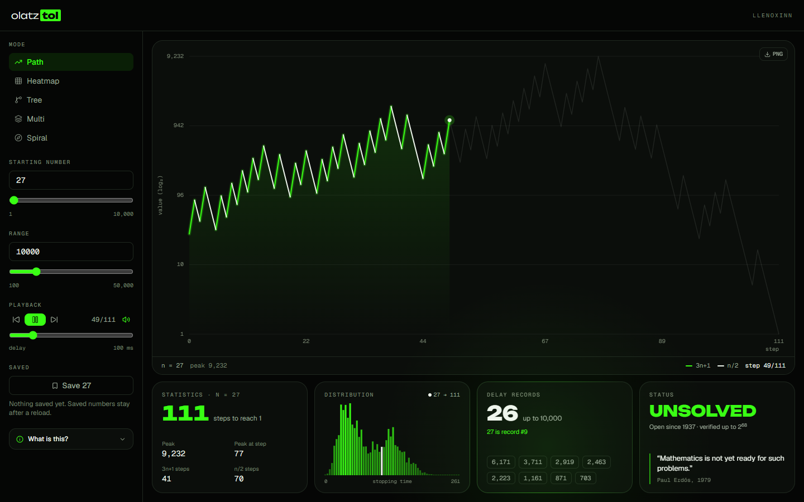

# olatz **tol**

**Watch any number fall to 1.** olatz tol is a Collatz conjecture visualizer: pick a starting number, apply the 3n + 1 rule, and follow its path through five views, with live statistics underneath.

<div align="center">




</div>

## Quick start

Requires Node.js 20.19+ or 22.12+.

```bash
npm install
npm run dev       # start the dev server
npm test          # run the math tests
npm run build     # production build in dist/
npm run preview   # serve the production build
```

## The conjecture

Take any positive integer *n* and apply the following rules:

- If *n* is even → divide by 2
- If *n* is odd → multiply by 3 and add 1
- Repeat until *n* = 1

The Collatz conjecture states that this process always terminates at 1, regardless of the starting value. It has been verified computationally for all integers up to 2<sup>68</sup> (approximately 2.95 × 10²⁰), yet no formal proof exists.

```
f(n) = n / 2      if n is even
f(n) = 3n + 1     if n is odd
```

**Example:** 6 → 3 → 10 → 5 → 16 → 8 → 4 → 2 → 1

Paul Erdős famously remarked: *"Mathematics is not yet ready for such problems"* (as cited in Lagarias, 1985, p. 4).

## What's inside

### Five views

Throughout the app, **neon green** marks a 3n + 1 step (the value climbs) and **white** marks an n / 2 step (it halves).

| Mode | What you see |
|------|--------------|
| **Path** | The sequence on a log₂ scale. The full path is drawn faintly, then lights up step by step as it plays; the peak is labelled once it is reached. |
| **Heatmap** | Every number in the range as one cell, colored by how many steps it takes. Hover a cell to read it, click it to make it the starting number. |
| **Tree** | All numbers in the range linked to their successor, with 1 at the bottom. The route of the current number is traced in white. |
| **Multi** | Two numbers on one step axis. Shows where their paths merge and how many steps apart they get there. |
| **Spiral** | Angle follows the step, radius follows the value, so the climb and fall become a spiral into the center. |

### Summary cards

Under the chart, a four-card bento grid tracks the current number and range:

- **Statistics**: steps to reach 1, the peak and when it happens, and the count of each step type.
- **Distribution**: a histogram of stopping times across the range, with the current number's bar in white.
- **Delay records**: numbers that take longer than every smaller number. Click one to load it.
- **Status**: the conjecture is still open.

The grid is a dependency-free take on [React Bits' MagicBento](https://reactbits.dev): card borders glow as the pointer gets close, a soft spotlight follows it, and clicks ripple.

### Other details

- **Intro**: each letter of *olatz* rides its own hailstone sequence and lands when it reaches 1, then *tol* bounces in and its box draws itself. Press any key or tap to skip. It shows a static logo when the OS asks for reduced motion.
- **Mode tabs**: sit on top of the chart, and the highlight slides between them. Arrow keys, Home and End switch views.
- **Playback**: play, pause, or step through a sequence at Slow, Normal or Fast speed. The Sound switch adds tones whose pitch follows the value.
- **What is this?**: a dialog that covers the rule, a step-by-step example (27) and a short history of the problem.
- **Saved numbers**: kept in `localStorage` and still there after a reload.
- **PNG export**: any view can be saved as a transparent PNG.
- **Responsive**: works from phone width up, and canvases render sharply on high-DPI screens.

## Tech stack

| Tool | Role |
|------|------|
| [Vite 8](https://vite.dev) | Dev server and build |
| [React 19](https://react.dev) | UI |
| [Tailwind CSS 4](https://tailwindcss.com) | Styling, configured in CSS through `@tailwindcss/vite` (no PostCSS or Tailwind config files) |
| [Zustand 5](https://zustand.docs.pmnd.rs) | App state, with `persist` for saved numbers |
| [Lucide](https://lucide.dev) | Icons |

All charts are drawn on plain `<canvas>`, and every animation uses CSS or the Web Animations API, so there's no chart or animation library. Tests use Node's built-in `node:test`.

## Project structure

```
src/
├── App.jsx                 page assembly
├── index.css               Tailwind import + design tokens (@theme)
├── components/
│   ├── Intro.jsx/.css      loading intro
│   ├── MagicBento.jsx/.css summary grid
│   ├── Layout.jsx          header, sidebar, main area
│   ├── controls/           mode, numbers, playback, compare, saved
│   ├── panels/             summary cards + "What is this?"
│   └── viz/                the five canvas views
├── hooks/                  playback/sound, container size
├── lib/                    Collatz math (+ tests), canvas helpers, layouts
└── store/                  Zustand store
```

### Palette

| Token | Hex | Use |
|-------|-----|-----|
| `ink` | `#050605` | page background |
| `panel` | `#0b0e0b` | cards |
| `line` | `#1f281f` | borders |
| `fg` | `#eef5ec` | text, n / 2 steps |
| `neon` | `#39ff14` | accent, 3n + 1 steps |

Fonts: [Unbounded](https://fonts.google.com/specimen/Unbounded) for the wordmark and big numbers, [Geist](https://vercel.com/font) for text, Geist Mono for figures.

## References

Collatz, L. (1986). On the motivation and origin of the (3n+1)-problem [in Chinese]. *Journal of Qufu Normal University, Natural Science Edition*, *12*(3), 9–11.

Krasikov, I., & Lagarias, J. C. (2003). Bounds for the 3x+1 problem using difference inequalities. *Acta Arithmetica*, *109*(3), 237–258. https://doi.org/10.4064/aa109-3-4

Lagarias, J. C. (1985). The 3x+1 problem and its generalizations. *The American Mathematical Monthly*, *92*(1), 3–23. https://doi.org/10.2307/2322189

Lagarias, J. C. (Ed.). (2010). *The ultimate challenge: The 3x+1 problem*. American Mathematical Society.

Simons, J., & de Weger, B. (2005). Theoretical and computational bounds for *m*-cycles of the 3*n*+1 problem. *Acta Arithmetica*, *117*(1), 51–70. https://doi.org/10.4064/aa117-1-3

Tao, T. (2022). Almost all orbits of the Collatz map attain almost bounded values. *Forum of Mathematics, Pi*, *10*, Article e12, 1–56. https://doi.org/10.1017/fmp.2022.8

Terras, R. (1976). A stopping time problem on the positive integers. *Acta Arithmetica*, *30*(3), 241–252.

Wirsching, G. J. (1998). *The dynamical system generated by the 3n+1 function* (Lecture Notes in Mathematics, Vol. 1681). Springer. https://doi.org/10.1007/BFb0095985
